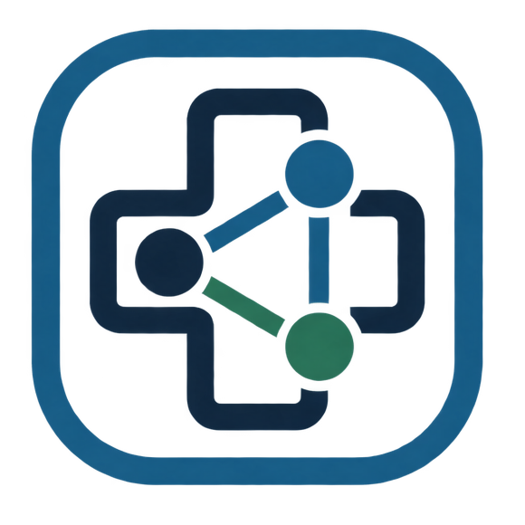

<table width="100%">
  <tr>
    <td align="center" width="120">
      
    </td>
    <td align="left" valign="middle">
      <h1>SCPO Connect</h1>
      <p><strong>Santa Casa de Pedro Osório</strong><br />Plataforma interna para equipes hospitalares</p>
    </td>
  </tr>
</table>

<p align="center"><strong>Cadastro de pacientes · Sinais vitais · Ordens de serviço · Acesso por módulos</strong></p>

## Sobre o projeto

O **SCPO Connect** reúne fluxos de trabalho hospitalares em uma aplicação web responsiva e instalável. A equipe pode consultar o cadastro compartilhado de pacientes conforme suas permissões, registrar sinais vitais e acompanhar sua evolução, além de abrir e acompanhar ordens de serviço.

O sistema foi desenvolvido para a Santa Casa de Pedro Osório. Os módulos e as permissões são atribuídos individualmente pelo administrador master.

## Recursos

- Cadastro central de pacientes com quarto, leito, data de nascimento, foto, contatos e endereços do paciente e do responsável pela internação; lista paginada com busca e filtros rápidos por situação, internação e quarto/leito. A guia Relatórios concentra filtros cadastrais avançados (perfil de tratamento, sexo e faixa de nascimento), busca independente e intervalo de datas, além de seleção e impressão conforme as permissões do perfil.
- Seletores de pacientes nos módulos assistenciais, administrativos e de recepção incluem busca por nome e identificadores/localização, mantendo a lista suspensa para seleção manual.
- Histórico individual de sinais vitais, com consulta separada e controle de acesso por perfil.
- Coleta de sinais vitais com autoria, histórico e gráficos de evolução por indicador.
- Enfermagem: registro de transferências e altas de pacientes com acomodação, com histórico; central de alergias e contraindicações com autoria, justificativa e resolução rastreável.
- Enfermagem: no campo de pressão, digite os números em sequência (12080 é formatado como 120/80); para sistólica abaixo de 100, use zero à esquerda, como 08570 → 085/70. Também é possível informar a barra manualmente.
- Enfermagem: ao registrar administração, exibe junto da dispensação selecionada a dose, via, frequência, duração e horários da prescrição vinculada para conferência; a quantidade lançada continua na unidade do lote e não há cálculo automático de dose/horário.
- Enfermagem: a impressão de etiquetas para copos com paciente, medicamento e horário está em avaliação e ainda não está disponível. O conteúdo, o momento de impressão e as conferências de segurança precisam ser validados com a equipe assistencial.
- Recepção: classificação manual da prioridade de chegadas à emergência; não substitui protocolo institucional de triagem.
- Gestão Hospitalar: mapa de leitos e indicadores agregados de ocupação, chegadas, coletas, fluxo, riscos cadastrais e alertas de estoque. O Semáforo comportamental permite localizar cadastros não excluídos, inclusive pacientes internados, com alta e sem leito, filtrando por nome/localização, situação do cadastro e classificação. Pacientes sem classificação são identificados; Gestão pode atribuir uma cor, com registro de autoria e auditoria, sem consultar observações clínicas. A ocupação percentual depende da reconciliação dos pacientes legados com o mapa.
- Os cartões da Visão geral mantêm o movimento suave de entrada e elevação ao passar o cursor; o movimento de hover é desativado quando o dispositivo solicita redução de movimento.
- Contas individuais, senha pessoal escolhida no bootstrap inicial, troca obrigatória de senhas temporárias de contas posteriores e autenticação multifator TOTP por QR code ou chave manual.
- Permissões por módulo e ações, verificadas também pelas APIs.
- Ordens de serviço com fluxos separados para Manutenção e Higienização; cada equipe acompanha sua própria fila e situação dos chamados.
- Os módulos Manutenção e Higienização exibem o ícone específico junto ao título, antes do nome, para facilitar a identificação da equipe em cada tela.
- Central de Exames: guias de Raio X, Eletrocardiograma e Exames laboratoriais; requisições vinculadas ao paciente, fila com filtros rápidos por situação e busca, e uma guia Relatórios separada para filtrar por situação/presença de resultado, pesquisar, delimitar período, selecionar e imprimir. O relatório não copia o texto clínico do resultado; a solicitação laboratorial também pode ser impressa no cadastro.
- Médico: resumo da fila triada por situação e prioridade, consulta de alergias e sinais vitais com gráficos, perfil CRM/UF, prescrição interna integrada à Farmácia e Enfermagem e receita simples para impressão (sem assinatura digital e sem medicamentos controlados). A tela organiza o fluxo em duas guias e mostra o perfil do prescritor junto à consulta de pacientes para reduzir conteúdo redundante no início. O PWA `/physician.html` oferece atalhos para a fila e para localizar pacientes, mantendo conexão, autenticação e permissões do módulo.
- PWAs instaláveis em paralelo ao aplicativo completo: Enfermagem (`/nursing.html`), Manutenção (`/maintenance.html`), Higienização (`/hygiene.html`), Farmácia (`/pharmacy.html`), Médico (`/physician.html`), Cozinha (`/kitchen.html`) e Lavanderia/Rouparia (`/laundry.html`). Manutenção e Higienização têm filas, manifestos e caches offline cifrados separados; `/operations.html` permanece como endereço legado compatível. Consulte [como instalar os PWAs](docs/pwa-installation.md). A disponibilidade e o fluxo de instalação variam conforme o navegador e o dispositivo.
- Nos PWAs, use o botão de sol/lua no cabeçalho para alternar entre tema claro e escuro. A preferência fica salva neste navegador e sincroniza com as outras abas do SCPO Connect.
- Visão geral: informativos publicados são exibidos em uma faixa compacta ao lado da saudação. Quando há mais de um comunicado, a faixa alterna automaticamente a cada 10 segundos; a rotação é desativada para usuários com redução de movimento configurada. Links externos continuam abertos em nova guia e informativos somente textuais ficam exibidos no próprio card.
- Atualizações do aplicativo: versões novas são detectadas em segundo plano. O sistema mantém a sessão atual aberta e mostra um aviso persistente com a ação **Atualizar agora**; o recarregamento automático só ocorre após a confirmação do usuário, quando o novo service worker é ativado.
- Serviço Social: encaminhamentos ligados ao paciente; a fila operacional usa busca, situação e prioridade, enquanto a guia Relatórios acrescenta filtros por categoria, responsável e prazo de retorno, com seleção e impressão sem consultar evoluções clínicas. A próxima ação impressa deve permanecer objetiva e sem dados clínicos.
- Farmácia: navegação por guias com botões visíveis para as áreas autorizadas, em computador e no celular. Inventário normalizado por produto, lote e local; movimentações com autoria e saldo resultante; leitura pela câmera de códigos de barras e QR com identificadores GTIN/GS1 reconhecidos, sugestões de identificação pelo catálogo público Anvisa/CMED e indicação informativa do lote válido com vencimento mais próximo (FEFO), sem seleção ou movimentação automática.
- Farmácia: os formulários, filtros, embalagens, dispensação, compras, relatórios e listas usam grades responsivas com alinhamento uniforme dos campos em telas de computador, tablet e celular. Os cards informativos de estoque mantêm suas cores, critérios e propriedades; os ajustes alteram somente espaçamento, largura de campos e comportamento responsivo.
- Farmácia: consulta alfabética consolidada do estoque de medicamentos e fila de prescrições médicas pendentes para conferência e dispensação.
- Farmácia: cartões informativos seguem o padrão visual compartilhado dos módulos. Os níveis são calculados pelo saldo válido do produto em relação às metas: Normal (verde), acima da meta média; Atenção (amarelo), acima do mínimo e até a meta média; Crítico (vermelho), no mínimo ou abaixo. Configure a meta média sempre acima do mínimo; produtos sem metas válidas aparecem como pendentes de configuração. Lotes vencidos não entram no saldo acompanhado.
- Farmácia: impressão de etiquetas por lote com medicamento, lote e validade. Ajuste largura/altura ao rolo e escolha 1, 5, 10 ou outra quantidade (até 500); a impressão usa o diálogo do navegador, sem conexão direta ou envio ZPL à Zebra ZD220. Escolha a impressora e o tamanho de papel correspondentes, desative cabeçalhos/rodapés e confira uma etiqueta antes da tiragem.
- Farmácia: o cadastro oferece três opções grandes e visuais: unidade avulsa, caixa externa com unidades ou caixa externa com caixas internas. O operador informa somente quantidades visíveis e recebe exemplos práticos antes da confirmação, enquanto o sistema calcula o saldo em unidade base; nomes e níveis adicionais ficam no fluxo avançado. GTIN, QR e descrição não determinam quantidades automaticamente. No Inventário, o operador pode mostrar cada lote em caixa externa, caixa interna ou unidade base, mantendo lotes, validade e semáforo verde/amarelo/vermelho. A guia **Como funciona** explica o fluxo e separa conversão de estoque de dose clínica.
- Visão geral e Farmácia: os quadros informativos podem entrar suavemente e se elevar ao passar o cursor. Nos controles rápidos, o botão de atividade ativa ou desativa essa preferência; ela é persistente neste navegador, sincronizada entre abas da mesma origem e sempre respeita a configuração de redução de movimento do sistema.
- Prescrição e Enfermagem: a hierarquia de embalagens calcula somente o saldo de estoque. Na dispensação, a quantidade da prescrição só é pré-preenchida quando sua unidade corresponde exatamente à unidade do lote; se não corresponder, fica vazia e exige conferência. Dose, via, frequência e horários continuam sendo definidos pelo prescritor; a Enfermagem confere a prescrição e registra o que foi efetivamente administrado. Não há conversão clínica automática entre mg, mL, comprimido ou outras unidades; qualquer regra desse tipo depende de apresentação exata e validação institucional.
- Farmácia: a guia Relatórios no computador filtra estoque por categoria, situação e validade, e movimentações por período, operação e lote; impressão de movimentações abrange a página exibida, com até 100 registros. Os relatórios não incluem prescrições ou informações clínicas. O catálogo público Anvisa/CMED é atualizado automaticamente todos os dias à meia-noite, horário de São Paulo, mantendo o catálogo anterior íntegro quando a consulta ou interpretação falhar. Usuários autorizados continuam podendo solicitar atualização manual; os dados obtidos são apenas sugestões GTIN/identificação e exigem conferência da equipe antes do cadastro.
- Nutrição: avaliação vinculada ao paciente, alerta cadastral de alergias, contexto da última avaliação e histórico paginado; a guia **Dietas e alertas** resume internados, alergias, dietas ausentes e jejuns em cartões alinhados ao padrão visual dos demais indicadores, com atalho para iniciar uma avaliação do paciente selecionado. O botão **Abrir painel da cozinha** fica no cabeçalho do módulo. O PWA `/kitchen.html` oferece busca e resumo dos indicadores operacionais, sem expor peso ou notas clínicas. Exige conexão, não guarda dados para uso offline e não registra preparo/entrega.
- Oficina Terapêutica: guias separadas para atividades e calendário, lista de presença, Biblioteca de imagens, Álbum de fotos, materiais e relatórios. A Biblioteca e o Álbum mantêm pastas e arquivos independentes; ambas exibem miniaturas clicáveis para ampliar a imagem dentro da própria guia, com navegação anterior/próxima por mouse e teclado. O botão Imprimir imagens imprime somente os resultados da pasta e busca atuais, sem controles da aplicação. Ambos aceitam envio, busca, organização em pastas, renomeação, movimentação, download e exclusão confirmada; pastas só podem ser excluídas quando vazias. No Dashboard técnico, o Superadministrador pode ativar/desativar cada recurso, definir cotas independentes e escolher subpastas independentes para a Biblioteca e o Álbum na seção Biblioteca e Álbum de fotos. Ao confirmar a mudança, os arquivos cadastrados daquele acervo são movidos; o caminho-base do host continua configurado pela TI. As cotas começam sem limite; reduzi-las preserva os arquivos existentes e bloqueia novos envios até haver espaço. O upload mostra progresso real em notificação com o ícone do app; exclusões mostram andamento indeterminado; as demais alterações concluídas também aparecem em toast. Notificações comuns de sucesso ou informação fecham automaticamente; erros permanecem abertos e podem ser copiadas para chamados, enquanto o progresso persiste até a operação terminar. Use somente imagens aprovadas institucionalmente e não inclua fotos identificáveis de pacientes sem as autorizações e o consentimento exigidos. Os arquivos ficam em volume próprio no host, separado do banco; o backup automático inclui Biblioteca e Álbum e a restauração isolada permite extraí-los sem sobrescrever arquivos ativos. Veja [Backup e restauração](docs/backups.md).
- Exclusão de contas com módulo Médico: o acesso é revogado imediatamente e a remoção da conta aguarda confirmação da exclusão do perfil no serviço de Enfermagem; falhas temporárias são repetidas automaticamente e ficam visíveis como exclusão pendente.
- Recepção: fluxos separados de admissão/internação e emergência; a chegada pode criar atomicamente um cadastro central sem quarto/leito ou vincular paciente existente. Ao cadastrar uma internação com leito físico selecionado, o vínculo, a ocupação do mapa e o evento de admissão devem ser registrados juntos; transferências e altas mantêm histórico e liberam/ocupam os leitos correspondentes.
- Recepção: os resumos de Agendamentos e Admissões/Leitos usam contagens reais por situação, cadastro e mapa de leitos. Leitos disponíveis só incluem leitos livres e com status disponível; falhas da consulta não são mostradas como saldo zero. Os cartões de Agendamentos têm largura e altura uniformes: cinco indicadores ficam alinhados em uma linha ampla e refluem para três, duas ou uma coluna conforme a tela.
- Quadros informativos da Recepção/Agendamentos, Nutrição/Dietas e alertas, Manutenção e Gestão Hospitalar/Visão geral agora têm apresentação visual própria, com cartões mais destacados, dimensões uniformes e organização responsiva; em telas amplas, Manutenção e os cartões textuais da Visão geral ficam em três colunas. Valores e ordem dos indicadores não mudam.
- Administração do Sistema: o dashboard do Superadministrador mostra conectividade técnica no topo, versão, controles globais por módulo, modo de manutenção, gestão das cotas de mídia e atalhos de backup. A conectividade confirma somente a resposta do endpoint de saúde. A seção “Contas com atividade nos últimos 5 minutos” mostra atividade autenticada recente, uma linha por conta, sem afirmar presença contínua; o acesso à lista é auditado. Métricas e gráficos históricos de recursos ainda estão planejados: o escopo acordado é coletar apenas dados dos containers/volumes do SCPO, com retenção de 30 dias e sem acesso ao Docker socket ou ao sistema de arquivos global do host. Use o switch de cada cartão para alterar disponibilidade ou modo de manutenção; o texto e o restante do cartão não acionam a mudança. A desativação de módulo ou acervo bloqueia o acesso correspondente sem apagar dados; o Superadministrador mantém acesso de manutenção aos módulos. Reduzir cotas de imagens não remove arquivos: novos envios são recusados enquanto o uso exceder o novo limite. O modo de manutenção pausa gravações de contas comuns sem interromper consultas, login, segurança da conta ou exportação de backup. O painel resume o último backup automático informado pelo serviço e oferece atalho para exportação manual. PWAs revalidam a disponibilidade enquanto estão conectados. No PWA da Enfermagem, pendências ainda não sincronizadas ficam cifradas no aparelho por até 24 horas e podem ser sincronizadas se o módulo for reativado nesse prazo.
- Backup: Administração do Sistema oferece exportação manual `.rgs` por senha, rotina automática por senha AES-GCM ou chave GPG legado, destino padrão `/backups` configurável pela TI e limite máximo em GB ajustável. Exportação e restauração mostram o andamento em uma notificação persistente fixa na tela com o ícone do app, independente da rolagem. Os botões de exportação, importação da chave pública e ativação da rotina se alinham aos respectivos campos. A restauração continua exigindo confirmação explícita, substitui os bancos ativos e cria cópias temporárias antes da substituição. Pode gerar um par com chave privada cifrada por senha no volume do servidor e baixar uma cópia igualmente cifrada para custódia independente; a senha não é armazenada. Consulte [Backup e restauração](docs/backups.md) para os riscos e a recuperação isolada.
- Conectividade e permissões: o cabeçalho do módulo indica se o serviço backend respondeu sem consultar dados de pacientes. Na Visão geral, selecionar um cartão bloqueado explica como solicitar acesso; a tentativa não abre nem consulta os dados do módulo. A disponibilidade global é consultada em `/api/v1/app/module-settings` no serviço de Acesso; Caddy de produção, Caddy local e Vite encaminham essa rota ao backend correto.
- Backup automático: Superadministrador configura frequência diária, intervalos em horas/dias, dias da semana ou do mês, horário local, quantidade de cópias (1–365) e cota em GB; `/backups` é o destino padrão e pode ser alterado pela TI. A retenção máxima existente de 30 dias continua valendo.
- Recepção: ficha ambulatorial entra na fila do pronto atendimento e permite classificar a chamada como comum ou prioritária, conforme o critério institucional.
- Enfermagem: a escala horária de medicações pode ser impressa em folha A4 por horário com uma linha por paciente e medicamento, com opção de registrar administração, recusa, indisponibilidade ou suspensão, preservando o motivo da exceção.
- Gestão e Administração: relatórios históricos paginados incluem triagens de Enfermagem e atendimentos ambulatoriais da Recepção, com busca por paciente, filtros por período e impressão conforme permissões.
- Sala de espera: abra `/painel` (também compatível com `/painel-sala-espera`) em um computador dedicado; a tela não exige sessão de operador e não expira com a sessão da Recepção. Mostra somente a chamada atual pelo primeiro nome e primeiro sobrenome, sem senha; cartões vermelhos indicam prioridade e cartões verdes chamadas comuns.
- Quiosque: configure o navegador do computador dedicado para iniciar em `https://SEU_HOST/painel` em modo quiosque. Para Chromium/Chrome gerenciado, a opção `--autoplay-policy=no-user-gesture-required` permite tentar ativar voz e toque ao iniciar; políticas do navegador/sistema ainda podem exigir clicar em **Ativar áudio** uma vez. Um toque sonoro curto antecede a chamada por voz.
- Proteção de tela da Recepção: configure e ative na subaba **Proteção de tela** do módulo Recepção → Painel de chamadas. Para adicionar imagens, salve arquivos institucionais aprovados em `public/reception-screensaver/` no app e reinicie o servidor local ou gere/publique uma nova versão. Após cinco minutos sem chamada nova, a tela pública alterna imagens; uma chamada interrompe os slides imediatamente na próxima atualização da fila (até cinco segundos). Use somente imagens sem pacientes, dados pessoais ou informações clínicas. Formatos aceitos: JPG/JPEG, PNG, WebP e AVIF; o manifesto é gerado automaticamente em desenvolvimento e build. A tela pública `/painel` não exibe controles de configuração.
- Ordens de Manutenção e Higienização: numeração sequencial compartilhada de sete dígitos, sem prefixos nem datas.
- Cadastro do paciente: status explícito de alergia (não verificado, sem alergia conhecida ou alergia conhecida), alerta visual nos fluxos clínicos e opção de responsável não aplicável ou autorreferência do paciente.
- Psicologia / Psiquiatria: fila de triagem com resumo por situação e prioridade, histórico individual de atendimentos e evolução estruturada, restritos às contas autorizadas no módulo.
- Higienização: solicitações por tipo de serviço, unidade e área, com prioridade, responsável e situação em fila própria, separada das ordens de manutenção.
- Caixa de tarefas: filas acionáveis de Recepção, Enfermagem, Farmácia, Manutenção e Higienização, filtradas pelas permissões da conta.
- Eventos instrumentados são enfileirados na mesma transação do serviço de origem, enviados com retentativas e registrados em cadeia de hashes append-only. A auditoria permite busca, filtros, paginação e verificação de integridade; mostra alerta para eventos pendentes há mais de cinco minutos ou com falhas repetidas. A retenção de 365 dias exclui somente um prefixo verificável de metadados de auditoria, nunca os registros de pacientes. A cobertura ainda precisa de revisão institucional e a imutabilidade do destino externo permanece não validada.
- Aplicação PWA principal, com instalação pela interface e atualização dos arquivos do app.
- PWA móvel da Enfermagem em `/nursing.html`, com manifesto próprio e acesso autenticado para coleta de sinais vitais, verificação horária e triagem. Glicemia, dor/algia e eliminações urinária e intestinal ficam na tela principal da coleta; os demais dados complementares permanecem opcionais e recolhidos. A glicemia é informada em mg/dL; registros legados em mmol/L são convertidos apenas para exibição/sincronização, sem alterar o histórico no servidor. A triagem exige conexão e não guarda rascunhos clínicos offline; ações offline de sinais vitais e verificação horária ficam cifradas por até 24 horas e são deduplicadas ao sincronizar. O login offline não é permitido.
- PWA de Manutenção (`/maintenance.html`) e PWA de Higienização (`/hygiene.html`), com manifestos e caches de leitura cifrados independentes por equipe, válidos por até 24 horas. Conectados, permitem atualizar situações conforme as permissões da conta; a liberação de leito na Higienização só é indicada após confirmação do servidor. Ao sair, o cache da equipe no aparelho é apagado. O login offline não é permitido.
- PWA da Farmácia em `/pharmacy.html`, com manifesto próprio, atalhos móveis para estoque, leitura de código pela câmera, prescrições e dispensação, usando as mesmas APIs e permissões da versão completa. O cadastro de compras continua na versão desktop; o PWA não guarda dados clínicos nem registra movimentações offline.
- PWA do Médico em `/physician.html`, com manifesto próprio e interface compacta para fila, prontuário e prescrições, usando as mesmas APIs/permissões do módulo completo. Exige conexão para consultar e salvar; não armazena prontuários localmente nem permite acesso offline.
- PWA da Cozinha em `/kitchen.html`, com manifesto próprio e consulta rápida dos dados alimentares necessários dos pacientes internados; exige conexão ao servidor, segue as permissões de Nutrição/Gestão/Administração e não grava andamento de preparo ou entrega.
- PWA da Lavanderia/Rouparia em `/laundry.html`, com manifesto e ícone próprios e interface mobile-first: formulário de solicitação recolhível, navegação horizontal e controles de toque. Permite cadastrar tipos de enxoval, abrir solicitações por unidade e acompanhar coleta, lavagem, estoque e devolução conforme as permissões da conta; exige conexão ao servidor.
- Interface responsiva para computadores, celulares e tablets.
- Menu lateral recolhível para uso mais eficiente em monitores menores e telas mais estreitas.
- Tela inicial offline: verifica a conexão a cada 30 segundos e recarrega o app somente quando o servidor voltar a responder; a verificação não roda nas telas autenticadas.
- Recepção: filas do operador ficam separadas em duas colunas (prioritários e comuns), com chamadas em linhas e opção de chamar manualmente um paciente específico.
- Enfermagem: verificação horária separa pacientes com e sem risco de evasão; o risco começa ativo e pode ser alterado por profissional autorizado, com registro de auditoria.
- Oficina terapêutica com abas de atividades/calendário, lista de presença e relatórios; resultados salvos ficam disponíveis digitalmente na aba Relatórios da Gestão Hospitalar, com impressão opcional.
- Sobre e Conformidade inicia em **Referências e conformidade**; as guias de ajuda e funcionamento ficam disponíveis ao lado.
- Saudação de bom dia, boa tarde ou boa noite em destaque e negrito na barra superior, conforme o horário de Brasília.

Na Farmácia, o catálogo Anvisa/CMED pode ser atualizado manualmente pelo botão da entrada de estoque ou automaticamente todos os dias à meia-noite, no fuso `America/Sao_Paulo`, por padrão. O agendamento pode ser desativado ou ajustado pelas variáveis `SCPO_ANVISA_AUTO_UPDATE`, `SCPO_ANVISA_UPDATE_RUN_TIME` e `SCPO_ANVISA_UPDATE_TIMEZONE`. A rotina consulta uma lista pública de preços apenas para sugerir GTIN, nome, princípio ativo, apresentação, fabricante e referência de registro. Uma falha mantém o catálogo anterior, registra o erro e permite nova tentativa; uma atualização bem-sucedida substitui apenas o catálogo de identificação em uma transação. A sugestão continua disponível localmente e não altera automaticamente produto, lote ou estoque. Antes de cadastrar, o responsável pela Farmácia precisa conferir e marcar explicitamente produto, princípio ativo, apresentação, unidade, embalagem, lote, validade e quantidade; a confirmação é registrada na auditoria com o usuário autenticado. A base não confirma autenticidade, registro ativo ou adequação clínica e não substitui a conferência da equipe.

Na visão geral, contas autenticadas podem consultar informativos institucionais publicados pelo aplicativo. Cada informativo pode ser um aviso, uma informação ou uma mudança de procedimento, com título, texto próprio opcional, resumo, link opcional, publicação e validade opcional. Assim, administradores podem comunicar notícias internas ou procedimentos sem depender de página externa. O Superadministrador e as contas da Administração com permissão de gestão podem criar, ativar, desativar e excluir informativos nas respectivas abas. A função é um canal interno e autenticado; ela não importa RSS externo automaticamente nem substitui a revisão de conteúdos de terceiros.

## Testes E2E

Execute `npx playwright install chromium` uma vez e depois `npm run test:e2e` para validar no navegador o fluxo Recepção → Triagem de Enfermagem → fila Médica. O comando inicia as APIs locais com bancos SQLite temporários, sobe o frontend Vite, configura uma conta sintética por bootstrap e MFA e remove o diretório de dados temporário ao terminar. Os testes usam apenas dados fictícios e não acessam o banco de demonstração nem a produção. É necessário ter `uv` disponível; traces e capturas de falha ficam em `test-results/`.

### Áreas de trabalho

Cadastro de pacientes, Enfermagem, Farmácia, Central de Exames, Médico, Serviço Social, Psicologia / Psiquiatria, Nutrição, Recepção, Oficina Terapêutica, Manutenção, Higienização, Lavanderia/Rouparia e Gestão Hospitalar.

## Arquitetura

| Camada | Tecnologias |
| --- | --- |
| Interface e PWA | React, TypeScript e Vite |
| APIs | Python, FastAPI, SQLAlchemy e Alembic |
| Desenvolvimento local | SQLite em `data/demo/` por padrão; pode ser configurado por `SCPO_LOCAL_DATA_DIR`, preservando `data/local/` |
| Instalação com containers | Docker Compose e PostgreSQL 17 |
| HTTPS interno | Caddy com autoridade certificadora local |

As APIs são separadas por domínio: Identidade e Acesso, Auditoria, Enfermagem e cadastro central de pacientes (incluindo Recepção e prescrições médicas), Farmácia, Oficina Terapêutica, Central de Exames, Serviço Social e Psicologia/Psiquiatria, além dos fluxos de Manutenção, Higienização e Lavanderia/Rouparia integrados ao backend de Manutenção e do serviço de Backup. Cada serviço possui migrações próprias e documentação OpenAPI em `/docs`.

## Executar para desenvolvimento

### Requisitos

- Node.js 24 ou superior e npm
- Python 3.11 ou superior e [uv](https://docs.astral.sh/uv/)
- Caddy 2 para servir o build local por HTTPS na rede; a porta HTTPS padrão é `7777`

Instale as dependências e gere os arquivos do PWA:

```bash
npm ci
uv sync
npm run build
```

Inicie as APIs em um terminal:

```bash
SCPO_COOKIE_SECURE=true bash scripts/dev-api.sh
```

Em outro terminal, informe o IP ou nome DNS da VM e inicie o Caddy:

```bash
read -r -p "IP ou DNS da VM: " SCPO_INTERNAL_HOST
export SCPO_INTERNAL_HOST
export SCPO_DEV_HTTPS_PORT=7777
caddy run --config Caddyfile.local --adapter caddyfile
```

Abra `https://<IP-ou-DNS-da-VM>:7777` em um dispositivo da rede local, substituindo o marcador pelo endereço informado. O Caddy local usa uma CA própria; para o navegador considerar a conexão confiável, instale a raiz pública `data/local/scpo-local-root.crt` em cada dispositivo e confira a impressão digital por um canal independente.

O lançador de desenvolvimento usa `data/demo/` por padrão, onde já estão os sete pacientes fictícios e suas 210 aferições de 30 dias. Os bancos antigos em `data/local/` permanecem intactos. Na primeira abertura, crie a conta inicial usando o token em `data/demo/bootstrap-admin.token`; defina o login `rgarcez` para habilitar o perfil exclusivo de Superadministrador do Sistema (ou configure `SCPO_SUPERADMIN_USERNAME` antes da migração). No cadastro inicial, escolha e confirme uma senha pessoal com pelo menos 12 caracteres; depois, configure a autenticação MFA. Contas comuns recém-criadas ou redefinidas pela Administração recebem a senha padrão `0000` e precisam trocá-la no primeiro login; quando já existe MFA, ele é mantido e continua exigido. Isso não altera a senha pessoal do superadministrador. Mantenha tokens e bancos locais fora do Git. Não use o ambiente demo para dados reais.

### Contas e perfis

Somente a Administração do aplicativo e o Superadministrador do Sistema podem administrar contas. A Administração do aplicativo atribui os módulos necessários, inclusive Médico ou Gestão Hospitalar, conforme aprovação institucional. Após criar uma conta com o módulo Médico, a Administração cadastra o nome profissional e o CRM/UF em **Perfis médicos**; o próprio médico consulta esses dados, mas não pode criá-los nem alterá-los. Confira as informações antes da emissão de prescrições. O login `rgarcez` é reservado ao Superadministrador do Sistema; esse acesso é distinto da Gestão Hospitalar e não aparece na lista de contas dos demais administradores. As funções de backup/restauração e a seleção das subpastas de backup e da biblioteca de imagens são exclusivas do Superadministrador; a TI precisa montar e autorizar os volumes no host. Nunca compartilhe sua conta ou credenciais.

Para desenvolver a interface com atualização instantânea, use `npm run dev -- --host 127.0.0.1`; o endereço local é `http://127.0.0.1:7777`. O Vite e o Caddy local usam essa mesma porta padrão, portanto não podem servi-la ao mesmo tempo: encerre um deles ou inicie o Vite com `--port 7778`. Para testar em outro computador da mesma rede, use, por exemplo, `npm run dev -- --host 0.0.0.0 --port 7778 --strictPort` e abra `http://<IP-da-VM>:7778` (por exemplo, `http://192.168.1.205:7778`). Esse modo usa HTTP sem TLS, serve apenas para testes controlados com dados demonstrativos e não deve ser exposto à Internet nem usado com dados reais. As APIs continuam escutando somente no loopback da VM. Se o acesso for bloqueado, libere a porta TCP escolhida na rede/firewall local. Os logs locais são gravados em `.logs/`.

## Instalação com Docker Compose

### Instalação automática em Debian 13 minimal

No computador de administração, conecte ao servidor por SSH, instale o Git se necessário e clone o repositório na versão aprovada. Depois, no servidor:

```bash
cd SCPO-Connect
sudo bash scripts/install-server-debian13.sh
```

O instalador configura o repositório oficial do Docker, instala Docker Engine e Compose, cria o `.env` e gera valores aleatórios para as variáveis secretas obrigatórias. Se já houver um `.env`, preserva os valores preenchidos e completa somente os campos secretos ausentes/vazios. Solicita o IP/DNS estável quando necessário, constrói e inicia os containers e aguarda as APIs ficarem saudáveis. Também cria e habilita `scpo-connect.service`, que inicia o Compose no boot e usa `docker compose stop` ao encerrar, sem remover volumes. Suporta Debian 13 com systemd. O `sudo` solicitará a senha diretamente no terminal; não a informe como argumento nem a grave em arquivos.

É seguro repetir o comando: o script não troca segredos preenchidos, não remove volumes e não importa dados. Em uma instalação nova, depois que os serviços iniciarem, o instalador consulta se o bootstrap ainda está pendente e exibe o token no terminal somente nesse caso. O token também fica guardado com permissões restritas em `data/local/bootstrap-admin.token`; use-o uma única vez e mantenha-o em sigilo. Se uma tentativa anterior falhou antes de exibi-lo, recupere-o no próprio servidor com `sudo cat data/local/bootstrap-admin.token`. O certificado raiz público do Caddy é exportado para `data/local/scpo-local-root.crt`; confira sua impressão digital por canal independente e instale-o nos dispositivos autorizados. Firewall, DNS/IP reservado, encaminhamento de portas e distribuição confiável do certificado continuam sendo tarefas da infraestrutura.

Este fluxo automatiza uma **instalação de validação**; não transfere o banco do PC atual e não representa autorização para dados reais. Para importar dados, use um backup cifrado e execute primeiro a restauração isolada descrita em [Backup e restauração](docs/backups.md). Nunca use `docker compose down -v` para atualizar ou reinstalar.

### Publicar uma atualização no servidor de testes

Depois de testar e fazer commit da versão aprovada na VM de desenvolvimento, siga o [procedimento de publicação e atualização do servidor de testes](docs/deploy-test-server.md). O comando padrão é:

```bash
bash scripts/deploy-test-server.sh
```

O script recusa alterações locais não commitadas e publica o `HEAD` por SSH. Ele não envia `.env`, bancos nem volumes, preservando a configuração, os usuários e os dados persistentes existentes no servidor. Use-o apenas para a instalação de validação.

Não inicie o Compose diretamente com um `.env.example` copiado: ele contém campos secretos vazios. Em Debian 13 com systemd, use o instalador acima, que gera/configura os segredos ausentes e inicializa os serviços. Em sistemas diferentes, o instalador automatizado ainda não é suportado; configure todas as variáveis `:?` listadas em `docker-compose.yml` com segredos fortes e exclusivos antes de executar:

```bash
docker compose up -d --build
```

Se o terminal responder `docker: command not found`, o Docker Engine/CLI não está instalado ou não está no `PATH`; o Compose não pode ser executado até isso ser corrigido. O comando de inicialização acima é `docker compose up -d --build` — `--compose` não é uma opção de `up`. Em Debian 13 com systemd, a partir da raiz do repositório, instale os componentes e inicie os serviços com:

```bash
sudo bash scripts/install-server-debian13.sh
docker --version
docker compose version
```

O instalador pedirá a senha do `sudo` diretamente no terminal. Em outra distribuição, siga a documentação oficial de instalação do Docker Engine e do plugin Docker Compose correspondente antes de executar `docker compose`.

Para conferir ou controlar a inicialização automática no servidor:

```bash
sudo systemctl status scpo-connect.service
sudo systemctl restart scpo-connect.service
```

O serviço é habilitado para iniciar com o sistema. Use `sudo systemctl stop scpo-connect.service` e `sudo systemctl start scpo-connect.service` para parar e iniciar a aplicação sem apagar bancos ou volumes.

O Caddy publica HTTP na porta `8080` para redirecionamento e HTTPS na porta `7777`. Exporte a raiz pública da CA com `bash scripts/export-caddy-ca.sh`, confira sua impressão digital e distribua-a por um canal controlado pela instituição. Preserve os volumes `postgres_data` e `caddy_data`; eles contêm, respectivamente, os bancos do sistema e a autoridade certificadora usada pelos dispositivos.

Após iniciar ou atualizar a implantação, confira `docker compose ps`: os serviços de API devem aparecer como `healthy`. Cada API possui um healthcheck HTTP em `/health`; o proxy aguarda as APIs ficarem saudáveis antes de iniciar. Essa verificação confirma disponibilidade básica, não valida fluxos do usuário nem substitui testes de restauração. Para investigar falhas, consulte `docker compose logs --tail=100 <serviço>` e confirme nos logs que as migrações terminaram.

## Verificações de desenvolvimento

Execute a partir da raiz do repositório, nesta ordem:

```bash
export PATH="$HOME/.local/bin:$PATH"
npm ci       # somente na primeira instalação ou após mudanças em package-lock.json
uv sync      # somente na primeira instalação ou após mudanças nas dependências Python
npm run typecheck
npm run lint
npm run build
uv run pytest backend/tests/test_therapy_reports.py backend/tests/test_audit.py backend/tests/test_migrations.py
uv run ruff check backend
```

`npm run build` valida a compilação de produção do frontend e gera as entradas PWA/service worker; não substitui os testes das APIs nem a construção de imagens Docker. Se Docker estiver instalado, `docker compose build` constrói as imagens da implantação. O Dockerfile frontend deve copiar todos os arquivos HTML de entrada do Vite, incluindo `laundry.html`; a imagem foi validada com esse ponto de entrada em 31/10/2026. Para investigar falhas de inicialização depois do build, use `docker compose ps` e `docker compose logs --tail=100 <serviço>`. Em 2026-10-31, no host de desenvolvimento `.205`, Docker CLI e Compose estavam acessíveis: as imagens `web`, `access` e `backup` foram construídas e os serviços locais foram reiniciados e verificados. Isso não valida a implantação em outro servidor nem substitui testes de ponta a ponta. Os testes E2E permanecem pausados.

## Segurança e dados

As contas locais são individuais, usam senha com derivação scrypt e MFA TOTP. Não há integração com provedor institucional de identidade. As sessões são assinadas e protegidas por cookie HttpOnly, com validade renovável de 12 horas enquanto o aplicativo estiver visível e conectado; a autorização é aplicada no servidor por módulo e ação. O HTTPS interno protege o tráfego somente nos aparelhos que confiam na CA do Caddy. O certificado TLS identifica o servidor e não substitui a autenticação do funcionário.

O uso real dos PWAs móveis de Enfermagem, Manutenção e Higienização foi autorizado pela direção dentro dos limites descritos em [preparação para piloto](docs/pilot-security-readiness.md). Essa autorização não se estende automaticamente aos demais módulos nem ao PWA Médico recém-disponibilizado. A auditoria tem outbox durável, alerta de backlog e retenção verificável de 365 dias; o backup automático é diário, cifrado e retido por 30 dias. A cobertura da auditoria ainda requer revisão e a imutabilidade do destino externo não foi validada. Antes de ampliar o uso com dados pessoais ou clínicos, validar matriz de acesso, fluxos, auditoria, recuperação, resposta a incidentes e requisitos de privacidade e segurança; consulte também [autenticação e permissões](docs/permissions.md). O sistema não interpreta sinais, diagnostica nem recomenda condutas clínicas.

Segredos, bancos locais, certificados e logs não devem ser enviados ao Git. O `.gitignore` exclui esses arquivos; mantenha `.env` apenas no servidor e use `.env.example` como modelo sem valores secretos.

## Preparação para operação

Antes de qualquer piloto com dados reais:

1. Revise e aprove a matriz de acessos e os fluxos de admissão, transferência, alta, leitos e estoque com TI, segurança, privacidade e equipes responsáveis. As contas atuais são locais; a implantação não está ligada a um diretório institucional.
2. Gere um backup e execute [restauração isolada](docs/backups.md) em bancos descartáveis, inclusive dos anexos de `.env`, Caddy e biblioteca terapêutica. A existência de um arquivo ou a passagem do healthcheck não comprova que a recuperação funciona.
3. A rotina automática está definida para execução diária às 02:00, com remoção de arquivos após 30 dias. A instituição ainda deve designar responsáveis e aprovar metas de perda de dados (RPO), tempo de recuperação (RTO), destino físico e teste da imutabilidade.
4. Observe tarefas reais em ambiente de teste e registre tempo, erros, retrabalho e dificuldades, inclusive em celular/tablet. A [preparação para piloto](docs/pilot-security-readiness.md) detalha os limites e controles pendentes.

Para os PWAs móveis, siga o escopo já autorizado e os controles definidos na documentação. Não estenda essa autorização aos demais módulos antes de concluir as validações correspondentes. Os healthchecks de Compose e os testes automatizados não equivalem à verificação do servidor hospitalar nem à aprovação geral para produção.

## Documentação

- [Arquitetura](docs/architecture.md)
- [Autenticação e permissões](docs/permissions.md)
- [Modelo de acesso ao cadastro de pacientes](docs/patient-access-model.md)
- [Preparação para piloto e segurança](docs/pilot-security-readiness.md)
- [Backup e restauração](docs/backups.md)
