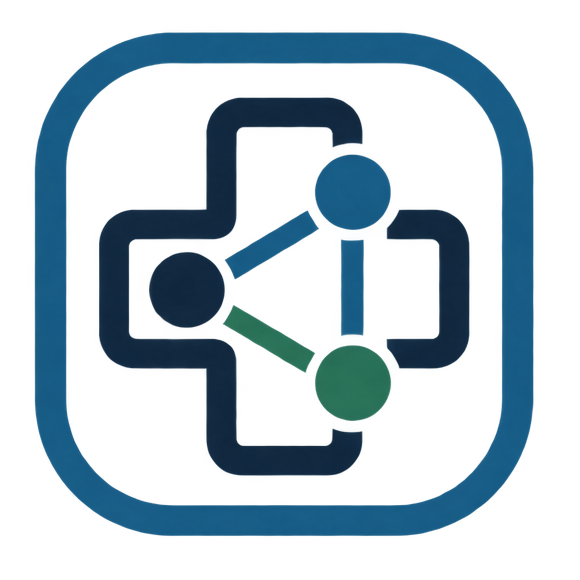

<table width="100%">
  <tr>
    <td align="center" width="120">
      
    </td>
    <td align="left" valign="middle">
      <h1>SCPO Connect</h1>
      <p><strong>Santa Casa de Pedro Osório</strong><br />Plataforma interna para equipes hospitalares</p>
    </td>
  </tr>
</table>

<p align="center"><strong>Cadastro de pacientes · Sinais vitais · Ordens de serviço · Acesso por módulos</strong></p>

## Sobre o projeto

O **SCPO Connect** reúne fluxos de trabalho hospitalares em uma aplicação web responsiva e instalável. A equipe pode consultar o cadastro compartilhado de pacientes conforme suas permissões, registrar sinais vitais e acompanhar sua evolução, além de abrir e acompanhar ordens de serviço.

O sistema foi desenvolvido para a Santa Casa de Pedro Osório. Os módulos e as permissões são atribuídos individualmente pelo administrador master.

## Recursos

- Cadastro central de pacientes com quarto, leito, data de nascimento, foto, contatos e endereços do paciente e do responsável pela internação; pessoas sem cadastro ou leito podem ser registradas na fila própria da emergência.
- Seletores de pacientes nos módulos assistenciais, administrativos e de recepção incluem busca por nome e identificadores/localização, mantendo a lista suspensa para seleção manual.
- Histórico individual de sinais vitais, com consulta separada e controle de acesso por perfil.
- Coleta de sinais vitais com autoria, histórico e gráficos de evolução por indicador.
- Enfermagem: registro de transferências e altas com histórico; central de alergias e contraindicações com autoria, justificativa e resolução rastreável.
- Recepção: classificação manual da prioridade de chegadas à emergência; não substitui protocolo institucional de triagem.
- Gestão Hospitalar: mapa de leitos e indicadores agregados de ocupação, chegadas, coletas, fluxo, riscos cadastrais e alertas de estoque. A ocupação percentual depende da reconciliação dos pacientes legados com o mapa.
- Contas individuais, senha pessoal escolhida no bootstrap inicial, troca obrigatória de senhas temporárias de contas posteriores e autenticação multifator TOTP por QR code ou chave manual.
- Permissões por módulo e ações, verificadas também pelas APIs.
- Ordens de serviço com fluxos separados para Manutenção e Higienização; cada equipe acompanha sua própria fila e situação dos chamados.
- Central de Exames: abas de Raio X e exames laboratoriais, requisições vinculadas ao paciente, fila por situação e formulário de solicitação para impressão.
- Médico: consulta de alergias e sinais vitais com gráficos, perfil CRM/UF, prescrição interna integrada à Farmácia e Enfermagem e receita simples para impressão (sem assinatura digital e sem medicamentos controlados). O PWA `/physician.html` oferece atalhos para a fila e para localizar pacientes, mantendo conexão, autenticação e permissões do módulo.
- Serviço Social: encaminhamentos ligados ao paciente, com busca, filtros e atualização de situação até o encerramento.
- Farmácia: inventário normalizado por produto, lote e local; movimentações com autoria e saldo resultante; leitura GS1, sugestões de identificação pelo catálogo público Anvisa/CMED e indicação informativa do lote válido com vencimento mais próximo (FEFO), sem seleção automática.
- Farmácia: consulta alfabética consolidada do estoque de medicamentos e fila de prescrições médicas pendentes para conferência e dispensação.
- Nutrição: avaliação vinculada ao paciente, alerta cadastral de alergias, contexto da última avaliação e histórico paginado; a guia **Mapa da cozinha** para computador resume internados, alergias, dietas ausentes e jejuns. O PWA `/kitchen.html` oferece busca simples e consulta móvel de dieta, alergias, restrições e jejum, sem expor peso ou notas clínicas. O PWA exige conexão, não guarda dados para uso offline e não registra preparo/entrega.
- Oficina Terapêutica: biblioteca de imagens com envio, busca, pastas simples, renomeação, movimentação, download e exclusão confirmada. Pastas só podem ser excluídas quando vazias. Os arquivos ficam em volume próprio no host, separado do banco; inclua esse diretório em backup protegido e teste sua restauração conforme [Backup e restauração](docs/backups.md).
- Exclusão de contas com módulo Médico: o acesso é revogado imediatamente e a remoção da conta aguarda confirmação da exclusão do perfil no serviço de Enfermagem; falhas temporárias são repetidas automaticamente e ficam visíveis como exclusão pendente.
- Recepção: fluxos separados de admissão/internação e emergência; a chegada pode criar atomicamente um cadastro central sem quarto/leito ou vincular paciente existente.
- Recepção: ficha ambulatorial entra na fila do pronto atendimento e permite classificar a chamada como comum ou prioritária, conforme o critério institucional.
- Enfermagem: a escala horária de medicações pode ser impressa em folha A4 por horário com uma linha por paciente e medicamento, com opção de registrar administração, recusa, indisponibilidade ou suspensão, preservando o motivo da exceção.
- Gestão e Administração: relatórios históricos paginados incluem triagens de Enfermagem e atendimentos ambulatoriais da Recepção, com busca por paciente, filtros por período e impressão conforme permissões.
- Sala de espera: abra `/painel` (também compatível com `/painel-sala-espera`) em um computador dedicado; a tela não exige sessão de operador e não expira com a sessão da Recepção. Mostra somente a chamada atual pelo primeiro nome e primeiro sobrenome, sem senha; cartões vermelhos indicam prioridade e cartões verdes chamadas comuns.
- Quiosque: configure o navegador do computador dedicado para iniciar em `https://SEU_HOST/painel` em modo quiosque. Para Chromium/Chrome gerenciado, a opção `--autoplay-policy=no-user-gesture-required` permite tentar ativar voz e toque ao iniciar; políticas do navegador/sistema ainda podem exigir clicar em **Ativar áudio** uma vez. Um toque sonoro curto antecede a chamada por voz.
- Proteção de tela da Recepção: configure e ative na subaba **Proteção de tela** do módulo Recepção → Painel de chamadas. Para adicionar imagens, salve arquivos institucionais aprovados em `public/reception-screensaver/` no app e reinicie o servidor local ou gere/publique uma nova versão. Após cinco minutos sem chamada nova, a tela pública alterna imagens; uma chamada interrompe os slides imediatamente na próxima atualização da fila (até cinco segundos). Use somente imagens sem pacientes, dados pessoais ou informações clínicas. Formatos aceitos: JPG/JPEG, PNG, WebP e AVIF; o manifesto é gerado automaticamente em desenvolvimento e build. A tela pública `/painel` não exibe controles de configuração.
- Ordens de Manutenção e Higienização: numeração sequencial compartilhada de sete dígitos, sem prefixos nem datas.
- Cadastro do paciente: status explícito de alergia (não verificado, sem alergia conhecida ou alergia conhecida), alerta visual nos fluxos clínicos e opção de responsável não aplicável ou autorreferência do paciente.
- Psicologia / Psiquiatria: fila de triagem com prioridade e situação, histórico individual de atendimentos e evolução estruturada, restritos às contas autorizadas no módulo.
- Higienização: solicitações por tipo de serviço, unidade e área, com prioridade, responsável e situação em fila própria, separada das ordens de manutenção.
- Caixa de tarefas: filas acionáveis de Recepção, Enfermagem, Farmácia, Manutenção e Higienização, filtradas pelas permissões da conta.
- Eventos instrumentados são enfileirados na mesma transação do serviço de origem, enviados com retentativas e registrados em cadeia de hashes append-only. A auditoria permite busca por usuário/ação/registro, filtro por módulo e período, paginação e verificação de integridade; ações do Superadministrador não são exibidas a administradores comuns. A cobertura da auditoria não é completa; monitoramento de filas, retenção institucional e cópia imutável externa continuam pendentes.
- Aplicação PWA principal, com instalação pela interface e atualização dos arquivos do app.
- PWA móvel da Enfermagem em `/nursing.html`, com manifesto próprio e acesso autenticado para coleta de sinais vitais, verificação horária e triagem. A triagem exige conexão e não guarda rascunhos clínicos offline; ações offline de sinais vitais e verificação horária ficam cifradas por até 24 horas e são deduplicadas ao sincronizar. O login offline não é permitido.
- PWA de Manutenção/Higienização em `/operations.html`, com manifesto próprio, consulta offline cifrada por até 24 horas e somente leitura. Quando conectado, permite atualizar o status e concluir ordens conforme as permissões da conta; ao sair, o cache operacional do aparelho é apagado. O login offline não é permitido.
- PWA da Farmácia em `/pharmacy.html`, com manifesto próprio, atalhos móveis para estoque, leitura de código pela câmera, prescrições e dispensação, usando as mesmas APIs e permissões da versão completa. O cadastro de compras continua na versão desktop; o PWA não guarda dados clínicos nem registra movimentações offline.
- PWA do Médico em `/physician.html`, com manifesto próprio e interface compacta para fila, prontuário e prescrições, usando as mesmas APIs/permissões do módulo completo. Exige conexão para consultar e salvar; não armazena prontuários localmente nem permite acesso offline.
- PWA da Cozinha em `/kitchen.html`, com manifesto próprio e consulta rápida dos dados alimentares necessários dos pacientes internados; exige conexão ao servidor, segue as permissões de Nutrição/Gestão/Administração e não grava andamento de preparo ou entrega.
- Interface responsiva para computadores, celulares e tablets.
- Menu lateral recolhível para uso mais eficiente em monitores menores e telas mais estreitas.
- Tela inicial offline: verifica a conexão a cada 30 segundos e recarrega o app somente quando o servidor voltar a responder; a verificação não roda nas telas autenticadas.
- Recepção: filas do operador ficam separadas em duas colunas (prioritários e comuns), com chamadas em linhas e opção de chamar manualmente um paciente específico.
- Enfermagem: verificação horária separa pacientes com e sem risco de evasão; o risco começa ativo e pode ser alterado por profissional autorizado, com registro de auditoria.
- Oficina terapêutica com abas de atividades/calendário, lista de presença e relatórios; resultados salvos ficam disponíveis digitalmente na aba Relatórios da Gestão Hospitalar, com impressão opcional.
- Sobre e Conformidade inicia em **Referências e conformidade**; as guias de ajuda e funcionamento ficam disponíveis ao lado.
- Saudação de bom dia, boa tarde ou boa noite conforme o horário de Brasília.

Na Farmácia, a atualização do catálogo Anvisa/CMED é manual e consulta a lista pública de preços de medicamentos apenas para sugerir GTIN, nome, princípio ativo, apresentação, fabricante e referência de registro. A sugestão só preenche o rascunho após ação do usuário; não cria produto/lote nem movimenta saldo. A base não confirma autenticidade, registro ativo ou adequação clínica e não substitui a conferência da equipe.

## Testes E2E

Execute `npx playwright install chromium` uma vez e depois `npm run test:e2e` para validar no navegador o fluxo Recepção → Triagem de Enfermagem → fila Médica. O comando inicia as APIs locais com bancos SQLite temporários, sobe o frontend Vite, configura uma conta sintética por bootstrap e MFA e remove o diretório de dados temporário ao terminar. Os testes usam apenas dados fictícios e não acessam o banco de demonstração nem a produção. É necessário ter `uv` disponível; traces e capturas de falha ficam em `test-results/`.

### Áreas de trabalho

Cadastro de pacientes, Enfermagem, Farmácia, Central de Exames, Médico, Serviço Social, Psicologia / Psiquiatria, Nutrição, Recepção, Oficina Terapêutica, Manutenção, Higienização e Gestão Hospitalar.

## Arquitetura

| Camada | Tecnologias |
| --- | --- |
| Interface e PWA | React, TypeScript e Vite |
| APIs | Python, FastAPI, SQLAlchemy e Alembic |
| Desenvolvimento local | SQLite em `data/demo/` por padrão; pode ser configurado por `SCPO_LOCAL_DATA_DIR`, preservando `data/local/` |
| Instalação com containers | Docker Compose e PostgreSQL 17 |
| HTTPS interno | Caddy com autoridade certificadora local |

As APIs são separadas por domínio: Identidade e Acesso, Auditoria, Enfermagem e cadastro central de pacientes (incluindo Recepção e prescrições médicas), Farmácia, Oficina Terapêutica, Central de Exames, Serviço Social e Psicologia/Psiquiatria, Manutenção e Higienização, além do serviço de Backup. Cada serviço possui migrações próprias e documentação OpenAPI em `/docs`.

## Executar para desenvolvimento

### Requisitos

- Node.js 24 ou superior e npm
- Python 3.11 ou superior e [uv](https://docs.astral.sh/uv/)
- Caddy 2 para servir o build local por HTTPS na rede; a porta HTTPS padrão é `7777`

Instale as dependências e gere os arquivos do PWA:

```bash
npm ci
uv sync
npm run build
```

Inicie as APIs em um terminal:

```bash
SCPO_COOKIE_SECURE=true bash scripts/dev-api.sh
```

Em outro terminal, informe o IP ou nome DNS da VM e inicie o Caddy:

```bash
read -r -p "IP ou DNS da VM: " SCPO_INTERNAL_HOST
export SCPO_INTERNAL_HOST
export SCPO_DEV_HTTPS_PORT=7777
caddy run --config Caddyfile.local --adapter caddyfile
```

Abra `https://<IP-ou-DNS-da-VM>:7777` em um dispositivo da rede local, substituindo o marcador pelo endereço informado. O Caddy local usa uma CA própria; para o navegador considerar a conexão confiável, instale a raiz pública `data/local/scpo-local-root.crt` em cada dispositivo e confira a impressão digital por um canal independente.

O lançador de desenvolvimento usa `data/demo/` por padrão, onde já estão os sete pacientes fictícios e suas 210 aferições de 30 dias. Os bancos antigos em `data/local/` permanecem intactos. Na primeira abertura, crie a conta inicial usando o token em `data/demo/bootstrap-admin.token`; defina o login `rgarcez` para habilitar o perfil exclusivo de Superadministrador do Sistema (ou configure `SCPO_SUPERADMIN_USERNAME` antes da migração). No cadastro inicial, escolha e confirme uma senha pessoal com pelo menos 12 caracteres; depois, configure a autenticação MFA. Contas comuns criadas ou redefinidas pela Administração recebem a senha provisória `0000` e precisam trocá-la no primeiro login; isso não altera a senha pessoal do superadministrador. Mantenha tokens e bancos locais fora do Git. Não use o ambiente demo para dados reais.

### Contas e perfis

Somente a Administração do aplicativo e o Superadministrador do Sistema podem administrar contas. A Administração do aplicativo atribui os módulos necessários, inclusive Médico ou Gestão Hospitalar, conforme aprovação institucional. Após criar uma conta com o módulo Médico, a Administração cadastra o nome profissional e o CRM/UF em **Perfis médicos**; o próprio médico consulta esses dados, mas não pode criá-los nem alterá-los. Confira as informações antes da emissão de prescrições. O login `rgarcez` é reservado ao Superadministrador do Sistema; esse acesso é distinto da Gestão Hospitalar e não aparece na lista de contas dos demais administradores. As funções de backup e restauração são exclusivas do Superadministrador do Sistema. Nunca compartilhe sua conta ou credenciais.

Para desenvolver a interface com atualização instantânea, use `npm run dev -- --host 127.0.0.1`; o endereço local é `http://127.0.0.1:7777`. Para testar em outro computador da mesma rede, inicie o Vite com `npm run dev -- --host 0.0.0.0 --strictPort` e abra `http://<IP-da-VM>:7777` (por exemplo, `http://192.168.1.205:7777`). Esse modo usa HTTP sem TLS, serve apenas para testes controlados com dados demonstrativos e não deve ser exposto à Internet nem usado com dados reais. As APIs continuam escutando somente no loopback da VM. Se o acesso for bloqueado, libere a porta TCP `7777` na rede/firewall local. Os logs locais são gravados em `.logs/`.

## Instalação com Docker Compose

### Instalação automática em Debian 13 minimal

No computador de administração, conecte ao servidor por SSH, instale o Git se necessário e clone o repositório na versão aprovada. Depois, no servidor:

```bash
cd SCPO-Connect
sudo bash scripts/install-server-debian13.sh
```

O instalador configura o repositório oficial do Docker, instala Docker Engine e Compose, cria o `.env` e gera valores aleatórios para as variáveis secretas obrigatórias. Se já houver um `.env`, preserva os valores preenchidos e completa somente os campos secretos ausentes/vazios. Solicita o IP/DNS estável quando necessário, constrói e inicia os containers e aguarda as APIs ficarem saudáveis. Suporta Debian 13 com systemd. O `sudo` solicitará a senha diretamente no terminal; não a informe como argumento nem a grave em arquivos.

É seguro repetir o comando: o script não troca segredos preenchidos, não remove volumes e não importa dados. Em uma instalação nova, depois que os serviços iniciarem, o instalador consulta se o bootstrap ainda está pendente e exibe o token no terminal somente nesse caso. O token também fica guardado com permissões restritas em `data/local/bootstrap-admin.token`; use-o uma única vez e mantenha-o em sigilo. Se uma tentativa anterior falhou antes de exibi-lo, recupere-o no próprio servidor com `sudo cat data/local/bootstrap-admin.token`. O certificado raiz público do Caddy é exportado para `data/local/scpo-local-root.crt`; confira sua impressão digital por canal independente e instale-o nos dispositivos autorizados. Firewall, DNS/IP reservado, encaminhamento de portas e distribuição confiável do certificado continuam sendo tarefas da infraestrutura.

Este fluxo automatiza uma **instalação de validação**; não transfere o banco do PC atual e não representa autorização para dados reais. Para importar dados, use um backup cifrado e execute primeiro a restauração isolada descrita em [Backup e restauração](docs/backups.md). Nunca use `docker compose down -v` para atualizar ou reinstalar.

### Publicar uma atualização no servidor de testes

Depois de testar e fazer commit da versão aprovada na VM de desenvolvimento, siga o [procedimento de publicação e atualização do servidor de testes](docs/deploy-test-server.md). O comando padrão é:

```bash
bash scripts/deploy-test-server.sh
```

O script recusa alterações locais não commitadas e publica o `HEAD` por SSH. Ele não envia `.env`, bancos nem volumes, preservando a configuração, os usuários e os dados persistentes existentes no servidor. Use-o apenas para a instalação de validação.

Não inicie o Compose diretamente com um `.env.example` copiado: ele contém campos secretos vazios. Em Debian 13 com systemd, use o instalador acima, que gera/configura os segredos ausentes e inicializa os serviços. Em sistemas diferentes, o instalador automatizado ainda não é suportado; configure todas as variáveis `:?` listadas em `docker-compose.yml` com segredos fortes e exclusivos antes de executar:

```bash
docker compose up -d --build
```

Se o terminal responder `docker: command not found`, o Docker Engine/CLI não está instalado ou não está no `PATH`; o Compose não pode ser executado até isso ser corrigido. O comando de inicialização acima é `docker compose up -d --build` — `--compose` não é uma opção de `up`. Em Debian 13 com systemd, a partir da raiz do repositório, instale os componentes e inicie os serviços com:

```bash
sudo bash scripts/install-server-debian13.sh
docker --version
docker compose version
```

O instalador pedirá a senha do `sudo` diretamente no terminal. Em outra distribuição, siga a documentação oficial de instalação do Docker Engine e do plugin Docker Compose correspondente antes de executar `docker compose`.

O Caddy publica HTTP na porta `8080` para redirecionamento e HTTPS na porta `7777`. Exporte a raiz pública da CA com `bash scripts/export-caddy-ca.sh`, confira sua impressão digital e distribua-a por um canal controlado pela instituição. Preserve os volumes `postgres_data` e `caddy_data`; eles contêm, respectivamente, os bancos do sistema e a autoridade certificadora usada pelos dispositivos.

Após iniciar ou atualizar a implantação, confira `docker compose ps`: os serviços de API devem aparecer como `healthy`. Cada API possui um healthcheck HTTP em `/health`; o proxy aguarda as APIs ficarem saudáveis antes de iniciar. Essa verificação confirma disponibilidade básica, não valida fluxos do usuário nem substitui testes de restauração. Para investigar falhas, consulte `docker compose logs --tail=100 <serviço>` e confirme nos logs que as migrações terminaram.

## Verificações de desenvolvimento

Execute a partir da raiz do repositório, nesta ordem:

```bash
export PATH="$HOME/.local/bin:$PATH"
npm ci       # somente na primeira instalação ou após mudanças em package-lock.json
uv sync      # somente na primeira instalação ou após mudanças nas dependências Python
npm run typecheck
npm run lint
npm run build
uv run pytest backend/tests/test_therapy_reports.py backend/tests/test_audit.py backend/tests/test_migrations.py
uv run ruff check backend
```

`npm run build` valida a compilação de produção do frontend e gera as entradas PWA/service worker; não substitui os testes das APIs nem a construção de imagens Docker. Se Docker estiver instalado, `docker compose build` constrói as imagens da implantação. Para investigar falhas de inicialização depois do build, use `docker compose ps` e `docker compose logs --tail=100 <serviço>`. Neste ambiente, Docker CLI 29.9.2 e Compose v5.6.1 estão disponíveis; a configuração Compose foi validada com um arquivo temporário de segredos descartáveis. Não foi feito build de imagens nem iniciado container porque o usuário atual não tem acesso ao socket Docker e o `sudo` requer autenticação interativa. Os testes E2E permanecem pausados.

## Segurança e dados

As contas locais são individuais, usam senha com derivação scrypt e MFA TOTP. Não há integração com provedor institucional de identidade. As sessões são assinadas e protegidas por cookie HttpOnly, com validade renovável de 12 horas enquanto o aplicativo estiver visível e conectado; a autorização é aplicada no servidor por módulo e ação. O HTTPS interno protege o tráfego somente nos aparelhos que confiam na CA do Caddy. O certificado TLS identifica o servidor e não substitui a autenticação do funcionário.

O uso real dos PWAs móveis de Enfermagem, Manutenção e Higienização foi autorizado pela direção dentro dos limites descritos em [preparação para piloto](docs/pilot-security-readiness.md). Essa autorização não se estende automaticamente aos demais módulos nem ao PWA Médico recém-disponibilizado. A auditoria possui outbox local durável e cadeia de hashes, mas não cobre todos os fluxos nem substitui monitoramento, backup imutável ou política institucional de retenção. Antes de ampliar o uso com dados pessoais ou clínicos, validar matriz de acesso, fluxos, auditoria, retenção, backups, resposta a incidentes e requisitos de privacidade e segurança; consulte também [autenticação e permissões](docs/permissions.md). O sistema não interpreta sinais, diagnostica nem recomenda condutas clínicas.

Segredos, bancos locais, certificados e logs não devem ser enviados ao Git. O `.gitignore` exclui esses arquivos; mantenha `.env` apenas no servidor e use `.env.example` como modelo sem valores secretos.

## Preparação para operação

Antes de qualquer piloto com dados reais:

1. Revise e aprove a matriz de acessos e os fluxos de admissão, transferência, alta, leitos e estoque com TI, segurança, privacidade e equipes responsáveis. As contas atuais são locais; a implantação não está ligada a um diretório institucional.
2. Gere um backup e execute [restauração isolada](docs/backups.md) em bancos descartáveis. A existência de um arquivo de backup ou a passagem do healthcheck não comprova que a recuperação funciona.
3. Defina institucionalmente responsável, frequência e retenção dos backups, além das metas de perda de dados (RPO) e tempo de recuperação (RTO). Esses parâmetros ainda não são definidos pelo repositório.
4. Observe tarefas reais em ambiente de teste e registre tempo, erros, retrabalho e dificuldades, inclusive em celular/tablet. A [preparação para piloto](docs/pilot-security-readiness.md) detalha os limites e controles pendentes.

Para os PWAs móveis, siga o escopo já autorizado e os controles definidos na documentação. Não estenda essa autorização aos demais módulos antes de concluir as validações correspondentes. Os healthchecks de Compose e os testes automatizados não equivalem à verificação do servidor hospitalar nem à aprovação geral para produção.

## Documentação

- [Arquitetura](docs/architecture.md)
- [Autenticação e permissões](docs/permissions.md)
- [Modelo de acesso ao cadastro de pacientes](docs/patient-access-model.md)
- [Preparação para piloto e segurança](docs/pilot-security-readiness.md)
- [Backup e restauração](docs/backups.md)
